# Manual Book CPOS (Centralized Palm Oil System)

Panduan pemakaian CPOS untuk semua pengguna, disusun per halaman sesuai urutan menu di sidebar.

- **Bagian A–B:** dasar pemakaian (login, tampilan, pola tabel & form) dan alur besar truk di pabrik.
- **Bagian C–G:** setiap menu (Dashboard, Mills Operation, Forms, Reports, Master).
- **Bagian H:** Konsol Admin.
- **Bagian I–J:** pertanyaan umum dan istilah.

> Gambar diambil dari data contoh (demo). Menu yang terlihat oleh setiap orang bisa berbeda: semuanya diatur di **Admin › Hak Akses**. Bila suatu menu tidak muncul, berarti Anda tidak diberi hak Lihat untuk menu itu.

Panduan terkait: `PANDUAN_CCTV.md` (pemasangan kamera), `PANDUAN_TAMPILAN_DAN_DATA_ORANG.md` (warna, cakupan data, data orang).

---

## Daftar isi

- [A. Dasar pemakaian](#a-dasar-pemakaian)
- [B. Alur besar: perjalanan truk di pabrik](#b-alur-besar-perjalanan-truk-di-pabrik)
- [C. Dashboard](#c-dashboard)
- [D. Mills Operation](#d-mills-operation)
- [E. Forms](#e-forms)
- [F. Reports](#f-reports)
- [G. Master](#g-master)
- [H. Konsol Admin](#h-konsol-admin)
- [I. Pertanyaan umum & masalah](#i-pertanyaan-umum--masalah)
- [J. Istilah](#j-istilah)

---

## A. Dasar pemakaian

### A.1 Masuk (login)

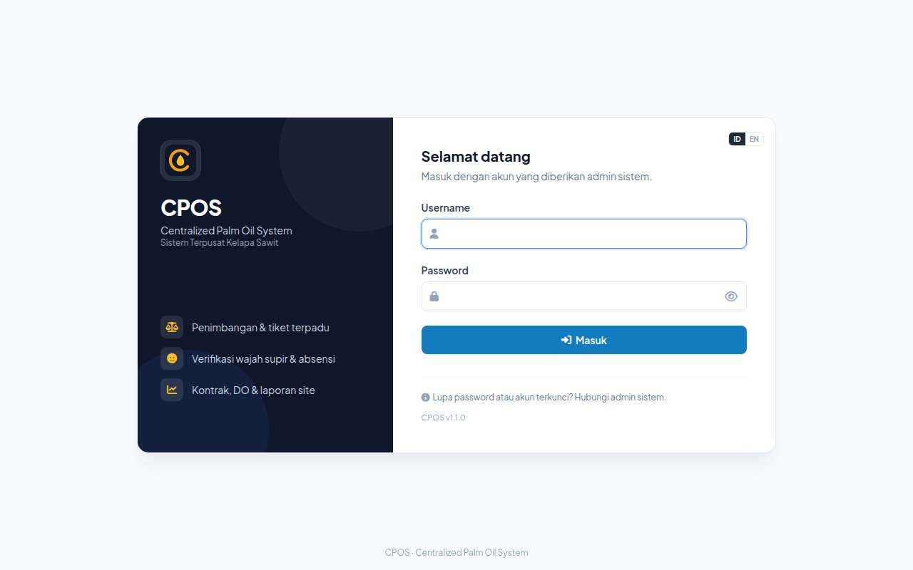

1. Buka alamat CPOS di browser (Chrome / Edge), mis. `http://192.168.10.5:5000`.
2. Isi **Username** dan **Password**, lalu tekan **Masuk** (atau Enter).
3. **Login pertama / password kedaluwarsa:** CPOS meminta membuat password baru.
   - Minimal 8 karakter.
   - Tidak boleh sama dengan password lama (dan beberapa password sebelumnya).
4. Bahasa bisa dipilih di halaman login (**ID / EN**).

Aturan keamanan (diatur Admin di **Pengaturan Site**):
- **Salah password berulang** (bawaan 5 kali dalam 15 menit) → akun terkunci sementara (bawaan 15 menit). Admin bisa membukanya di **Sesi Aktif**.
- **Tidak aktif lama** (bawaan 120 menit) → keluar otomatis. 2 menit sebelumnya muncul peringatan dengan tombol **Tetap masuk**.
- **1 user 1 perangkat** (bila aktif): login di perangkat lain mengakhiri sesi di perangkat sebelumnya.

### A.2 Bagian-bagian layar

| Bagian | Letak | Fungsi |
|---|---|---|
| **Menu samping (sidebar)** | kiri | Daftar menu sesuai hak Anda, dikelompokkan: Dashboard, Mills Operation, Forms, Reports, Master. Menu ber-anak (mis. Stasiun Timbang) bisa dibuka-tutup |
| **Tombol ☰** | kiri atas | Menyembunyikan / menampilkan menu samping. Di tablet, menu samping muncul sebagai laci di atas layar dan tertutup lagi saat mengetuk di luar menu |
| **Breadcrumb** | atas, sebelah ☰ | Posisi Anda, mis. *CPOS / Mills Operation / Pos Security* (sama dengan jalur di sidebar) |
| **Kotak cari (Ctrl + K)** | atas tengah | Cari cepat plat, No. Tiket, No. DO, supir, atau nama menu. Tekan `Ctrl + K` dari halaman mana pun |
| **Tiket Baru** | kanan atas | Langsung membuka Stasiun Timbang › Security (hanya bila punya hak tambah tiket) |
| **Lonceng** | kanan atas | Notifikasi, mis. DO melebihi kuota, pengajuan yang menunggu persetujuan Anda |
| **Nama & jabatan** | kanan atas | Akun yang sedang dipakai |
| **Tombol keluar** | paling kanan atas | Logout |
| **ID / EN** | kiri bawah | Ganti bahasa tampilan |
| **Tombol ↑** | kanan bawah | Muncul saat halaman digulir jauh; kembali ke atas |

### A.3 Pola tabel (sama di semua halaman)

- **Urutkan:** klik judul kolom (ada ikon ⇅). Klik sekali = naik, klik lagi = turun. Angka, tanggal, dan teks diurutkan dengan benar.
- **Saat memuat:** tabel menampilkan garis-garis abu-abu berkedip sampai data datang.
- **Data kosong:** ikon folder + pesan, mis. "Belum ada data". Kadang ada tombol untuk langsung menambah.
- **Kaki tabel** (bawah tabel):
  - kiri: "Menampilkan 1–20 dari 57";
  - **Excel** = unduh file `.xlsx` berisi semua baris yang lolos pencarian/filter (semua halaman);
  - **PDF** = cetak / simpan PDF (pilih "Simpan sebagai PDF" di dialog cetak);
  - kanan: jumlah baris per halaman (10 / 20 / 50 / 100, diingat per pengguna) dan tombol **‹ Sebelumnya / Berikutnya ›**.
- **Kolom** (di beberapa tabel): tombol untuk menampilkan / menyembunyikan kolom; ikut terbawa ke ekspor.
- **Format:** tanggal `28-10-2026`, jam `14:30`, angka dengan pemisah ribuan titik (`28.500 kg`), desimal koma (`21,50`).
- **Tombol aksi** berupa ikon: ✏️ ubah, 🗑 hapus, 👁 detail, 🖨 cetak, dll. Arahkan mouse ke ikon untuk melihat namanya.

### A.4 Pola form (sama di semua halaman)

- **Tanda `*` merah** di label = wajib diisi.
- **Isian salah / kosong:** pesan merah muncul tepat di bawah isian itu dan kotaknya berbingkai merah. Pesan hilang begitu isiannya diperbaiki.
- **Pesan dari server** (mis. "Username admin sudah dipakai") juga muncul di bawah isian yang bersangkutan, selain notifikasi pop-up.
- **Tombol utama** (Simpan) selalu di kanan bawah form; **Batal** di sebelah kirinya.
- **Pilihan dengan pencarian:** klik kotak pilihan, lalu ketik untuk menyaring daftar.
- **Huruf otomatis:**
  - plat → huruf besar dan dirapikan (`bm8821ka` → `BM 8821 KA`);
  - kode / No. DO / SIM → huruf besar;
  - username → huruf kecil.
- **Esc** menutup jendela (modal) yang sedang terbuka.
- **Konfirmasi:** aksi penting (hapus, batalkan) selalu menanyakan dulu lewat kotak konfirmasi. Ikon merah ⚠ berarti aksi berbahaya.
- **Notifikasi pop-up** di kanan atas: hijau = berhasil, merah = gagal, kuning = peringatan, biru = info.

### A.5 Peran bawaan (contoh data awal)

| Peran | Biasanya membuka |
|---|---|
| Head Office (HO) | Dashboard, Analytics, RekapIn, Kontrak & DO, Master, Blacklist (setujui), Monitoring CCTV |
| Security | Pos Security, Logbook, Stasiun Timbang › Security, Visitor & Staff Logs, Monitoring CCTV |
| Operator Timbang | Stasiun Timbang › Timbangan, Kelebihan DO, Request Operator |
| Sortasi | Stasiun Timbang › Sortasi |
| Laboratorium | Stasiun Timbang › Laboratorium |
| Admin | Konsol Admin (pengguna, hak akses, organisasi, perangkat, dll.) |

Hak sebenarnya selalu mengikuti **Admin › Hak Akses**.

---

## B. Alur besar: perjalanan truk di pabrik

```
Pos Security (masuk) → Timbang 1 (bruto/tara) → Sortasi (TBS) / Laboratorium (produk PKS) → Timbang 2 → Pos Security (keluar)
```

- **Urutan tahap per produk & area** diatur di **Admin › Alur Tiket**. Contoh bawaan:
  - TBS: timbang – sortasi – timbang;
  - Produk PKS (CPO, kernel): timbang – lab – timbang;
  - Penimbangan saja (sekali timbang);
  - Pos Security saja (catat masuk / keluar tanpa timbang).
- **Setiap tiket punya nomor**, mis. `PKS-261028-004` (kode area – tanggal yymmdd – urutan).
- **Status tiket:** Registrasi Security → Timbang 1 → Sortasi / Inspeksi → Timbang 2 → Menunggu Keluar → Selesai. Bisa juga **Ditolak** (lab tolak) atau **Dibatalkan** (void).
- **DO:** tiket terhubung ke DO (Kontrak & DO). Bila netto melewati kuota DO, kelebihannya dipecah menjadi tiket `-S1` dan diurus di **Kelebihan DO**.

---

## C. Dashboard

### C.1 Dashboard

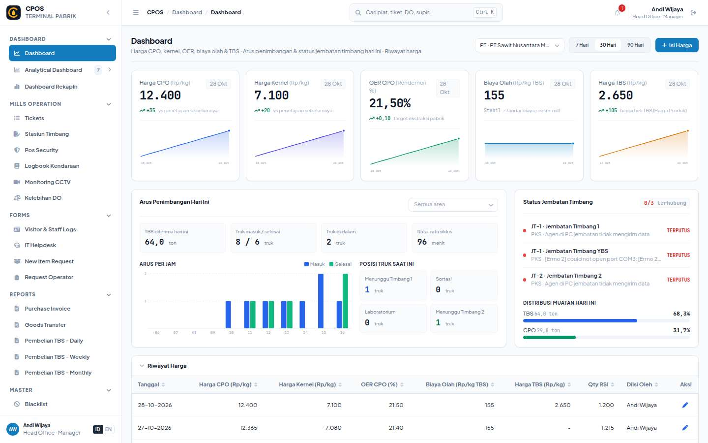

**Fungsi:** ringkasan harian. Isi kartu (widget) berbeda per peran; diatur di Admin › Hak Akses (kolom Isi Dashboard).

| Widget | Isi |
|---|---|
| **Harga** | Harga CPO, Kernel, OER CPO, Biaya Olah, Harga TBS terakhir + grafik tren & selisih dari penetapan sebelumnya |
| **Arus Penimbangan** | TBS diterima hari ini, truk masuk/selesai, truk di dalam, rata-rata siklus, arus per jam, posisi truk per tahap |
| **Status Jembatan Timbang** | Jembatan yang terhubung / terputus dan alasannya; distribusi muatan hari ini |
| **Riwayat Harga** | Tabel harga per tanggal; ✏️ untuk mengubah (bila punya hak) |
| **Security** | Truk masuk & di dalam area, tamu, blacklist terdeteksi hari ini |

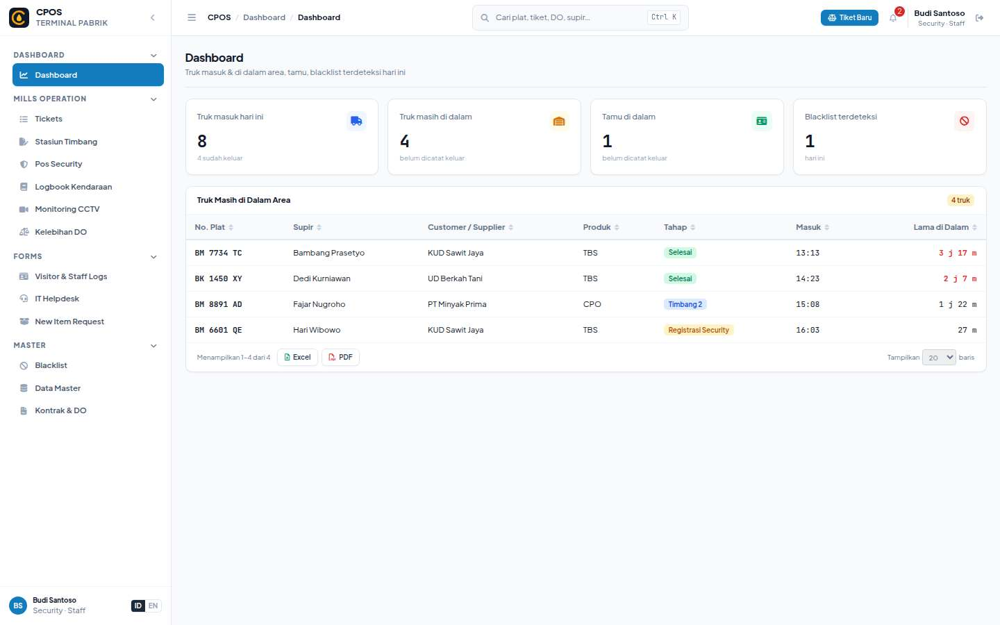

Langkah umum:
1. Pilih **perusahaan (PT)** di kanan atas (bila punya akses lebih dari satu PT).
2. Pilih rentang **7 / 30 / 90 Hari** untuk grafik.
3. **Isi Harga** (bila punya hak): isi harga harian; tanggal yang sudah ada harganya akan diperbarui.

### C.2 Analytical Dashboard (Analytics)

Menu ber-anak berisi laporan analisis dari data Ascend (ERP):

| Laporan | Isi singkat |
|---|---|
| PR & PO Outstanding | Purchase Request & Purchase Order yang belum selesai |
| PO & PI Outstanding | PO yang belum ditagih (Purchase Invoice) |
| PVR KPI / PV KPI | Penilaian KPI proses PVR dan PV |
| Weighbridge Fraud Analyst | Pola penimbangan janggal (risiko kecurangan) |
| TBS Transaction Analyst | Analisis transaksi penerimaan TBS |
| Pembelian TBS Mingguan | Rekap pembelian TBS per minggu |

Cara pakai:
- Pilih laporan di sidebar; laporan terbuka di dalam CPOS.
- Atur **rentang tanggal** dan **perusahaan** di laporan.
- Hak: hanya **Lihat** (Admin › Hak Akses). PT yang tampil mengikuti **Cakupan data**.
- Catatan: isi laporan Analytics saat ini berbahasa Indonesia saja (aplikasi terpisah); tombol ID/EN hanya mengubah bingkai CPOS di sekelilingnya.

### C.3 Dashboard RekapIn

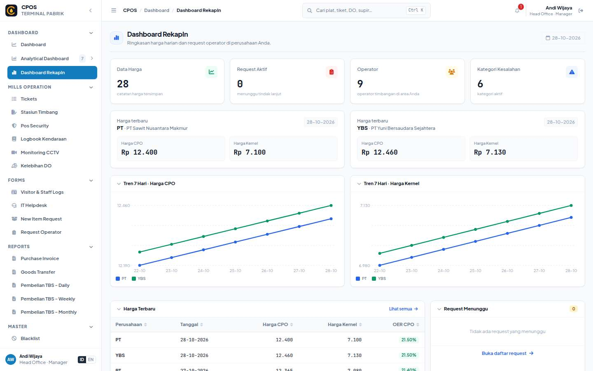

- Ringkasan harga harian dan Request Operator di perusahaan Anda.
- Kartu: jumlah data harga, kategori kesalahan aktif, harga terbaru (grafik 7 hari), request yang menunggu.
- Tautan cepat: **Lihat semua** (harga) dan **Buka daftar request**.

---

## D. Mills Operation

### D.1 Tickets (daftar & rekap tiket)

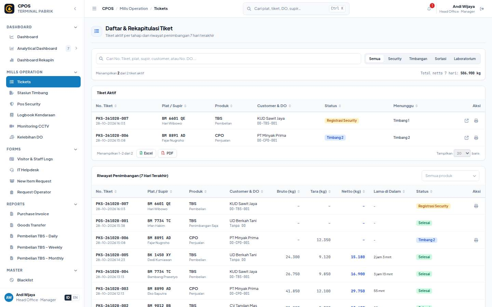

- **Catatan:** menu **Tickets** di sidebar saat ini masih halaman "Konten menyusul" (tahap 1). Daftar tiket yang sudah berjalan dibuka dari **Stasiun Timbang › tombol Kembali ke Daftar Tiket**, atau alamat `/weighbridge?view=list`.
- **Atas:**
  - kotak cari (No. Tiket, plat, supir, customer, No. DO);
  - chip tahap: Semua / Security / Timbangan / Sortasi / Laboratorium;
  - total netto 7 hari.
- **Tiket Aktif:** tiket yang masih berjalan, kolom Menunggu = tahap berikutnya.
  - ↗ membuka tiket di Stasiun Timbang;
  - 🖨 mencetak slip.
- **Riwayat Penimbangan (7 hari):** bruto, tara, netto, lama di dalam, status; bisa disaring per produk.
  - **Periksa** (hak Setujui): menandai tiket sudah diperiksa.
  - **Ajukan Koreksi:** mengajukan perubahan data tiket (plat, supir, dll.); diproses lewat Alur Persetujuan, bagian **Pengajuan** di bawah halaman.

### D.2 Stasiun Timbang

Satu halaman dengan **info bar** di atas (No. Tiket, plat, DO, customer, produk, jenis transaksi, supir, foto) dan 4 tab sesuai tahap. Tab yang terlihat sesuai hak.

#### D.2.1 Tab Security (pendaftaran tiket)

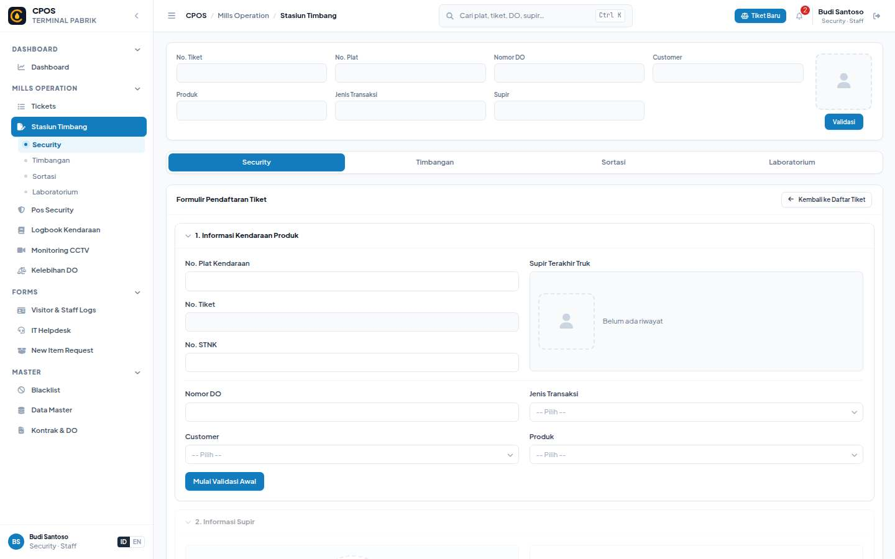

1. **Informasi Kendaraan & Produk**
   - Ketik **No. Plat** lalu Enter: supir terakhir truk, status blacklist, dan kendaraan terdaftar langsung dicek.
   - Isi No. STNK, **Nomor DO** (Enter untuk mencari DO), Jenis Transaksi, Customer, Produk.
   - Tekan **Mulai Validasi Awal**.
2. **Informasi Supir**
   - Supir diverifikasi lewat **scan wajah** (kamera).
   - Supir berbeda dari supir terakhir → CPOS meminta konfirmasi.
3. **Simpan & Cetak QR:** tiket dibuat, QR tiket dicetak untuk ditempel / dibawa supir ke jembatan timbang.

Tips:
- Kendaraan / supir yang di-blacklist langsung ditolak dengan alasan.
- **Tiket Baru** (kanan atas) selalu membuka tab ini dalam keadaan kosong.

#### D.2.2 Tab Timbangan

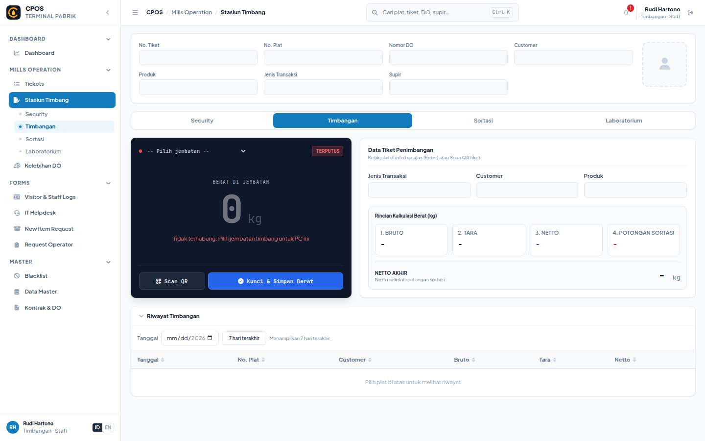

1. **Pilih jembatan timbang** di panel hitam (sekali per PC; diingat).
   - Status **TERHUBUNG** = angka berat dari indikator masuk.
   - **TERPUTUS** = cek kabel / agen PC (Admin › Perangkat).
2. Panggil tiket: ketik plat di info bar lalu Enter, atau tekan **Scan QR** dan arahkan QR tiket.
3. Tunggu angka **stabil**, lalu tekan **Kunci & Simpan Berat**.
   - Timbang 1 = bruto (TBS masuk) / tara (truk kosong untuk penjualan).
   - Timbang 2 = pasangannya.
4. **Rincian Kalkulasi Berat:** Bruto, Tara, Netto, Potongan Sortasi, **Netto Akhir**.

Pengaman bawaan:
- **Timbangan harus kembali ke 0** sejak penimbangan sebelumnya (truk sebelumnya sudah turun). Bila angka tetap tersisa / minus, tekan ZERO di indikator.
- **Tara jauh dari berat kosong** jenis kendaraan → peringatan (batas % di Pengaturan Site).
- **Netto melebihi kuota DO** → kelebihan dipecah ke tiket `-S1` (lihat D.6).

**Riwayat Timbangan:** riwayat plat yang dipanggil; bisa pilih tanggal atau 7 hari terakhir.

#### D.2.3 Tab Sortasi

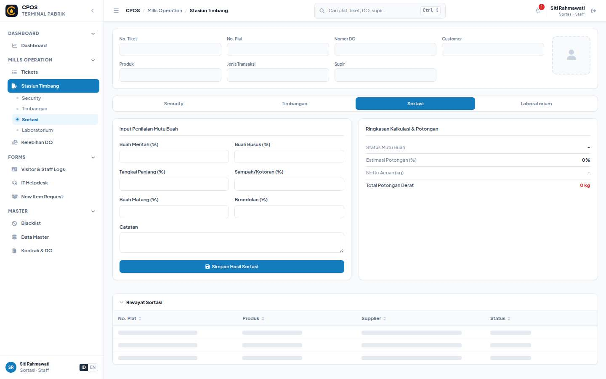

1. Panggil tiket TBS (plat / QR) setelah Timbang 1.
2. Isi persentase: **Buah Mentah, Buah Busuk, Tangkai Panjang, Sampah/Kotoran, Buah Matang, Brondolan**, dan catatan.
3. Panel kanan menghitung **Status Mutu Buah, Estimasi Potongan (%), Netto Acuan, Total Potongan Berat**.
4. **Simpan Hasil Sortasi.** Potongan ikut terhitung di Netto Akhir saat Timbang 2.

#### D.2.4 Tab Laboratorium

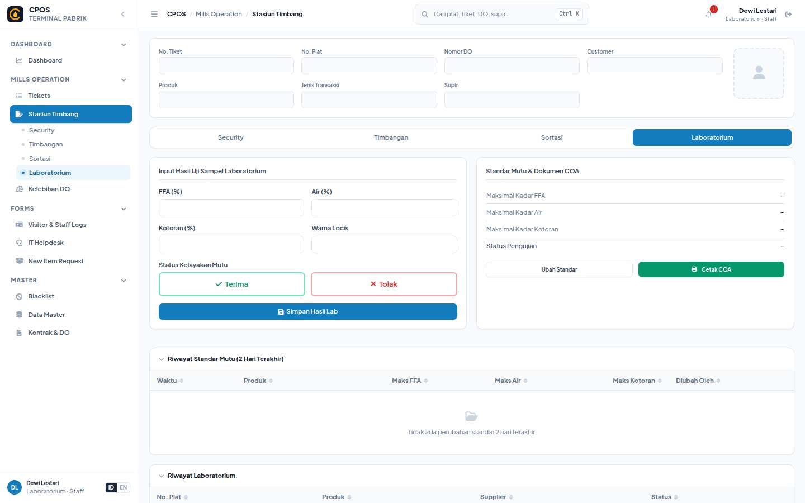

1. Panggil tiket produk PKS (CPO / kernel).
2. Isi **FFA (%), Air (%), Kotoran (%), Warna Locis**.
3. Pilih **Terima** atau **Tolak**, lalu **Simpan Hasil Lab**.
   - Tolak → tiket berstatus Ditolak; truk tetap ditimbang keluar sesuai alur.
4. Panel kanan: standar mutu produk (maks FFA, air, kotoran) dan status pengujian.
   - **Ubah Standar** (hak Ubah): mengubah standar mutu; perubahan tercatat di "Riwayat Standar Mutu".
   - **Cetak COA:** Certificate of Analysis untuk tiket ini.

### D.3 Pos Security

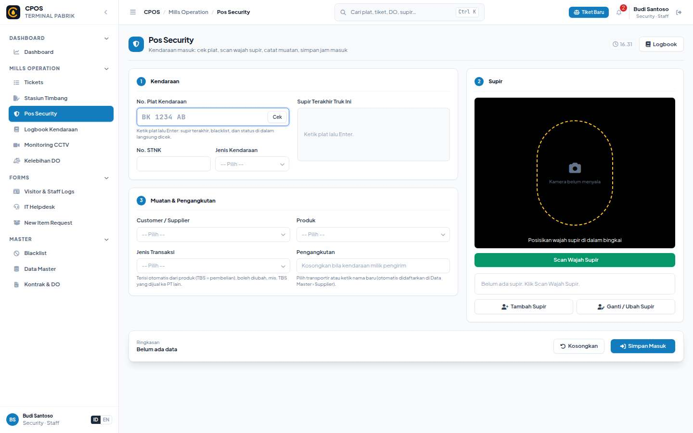

**Fungsi:** pencatatan kendaraan masuk yang cepat untuk pos jaga (cocok di tablet).

1. **Kendaraan:**
   - ketik No. Plat lalu Enter / **Cek**: muncul supir terakhir truk, status blacklist, dan apakah truk masih tercatat di dalam;
   - isi No. STNK dan Jenis Kendaraan.
2. **Supir:** scan wajah supir dengan kamera.
3. **Muatan & Pengangkutan:**
   - Customer / Supplier, Produk;
   - Jenis Transaksi (terisi otomatis dari produk; boleh diubah, mis. TBS dijual ke PT lain);
   - Pengangkutan (kosongkan bila kendaraan milik pengirim).
4. **Ringkasan** di bawah → **Simpan Masuk**. **Kosongkan** untuk mengulang.

- Jam di kanan atas = jam server.
- Tombol **Logbook** membuka D.4.

### D.4 Logbook Kendaraan

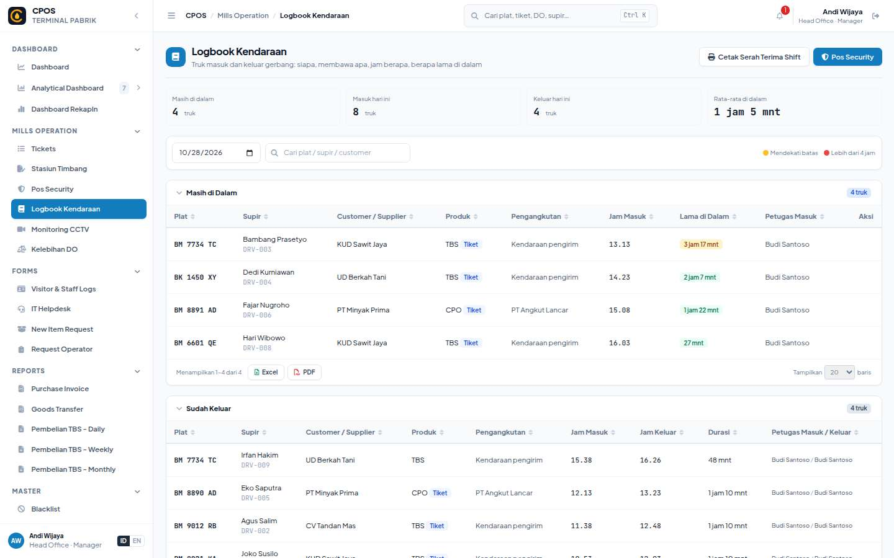

- **Masih di Dalam:** truk yang sudah masuk dan belum keluar.
  - Lama di dalam ditandai bila melewati batas jam (Pengaturan Site › Pos Security).
  - **Catat Keluar** untuk truk yang keluar.
- **Sudah Keluar:** riwayat truk keluar.
- **Cari:** plat / supir / customer.
- **Cetak serah terima** jaga (antar shift); ekspor Excel / PDF di kaki tabel.

### D.5 Monitoring CCTV

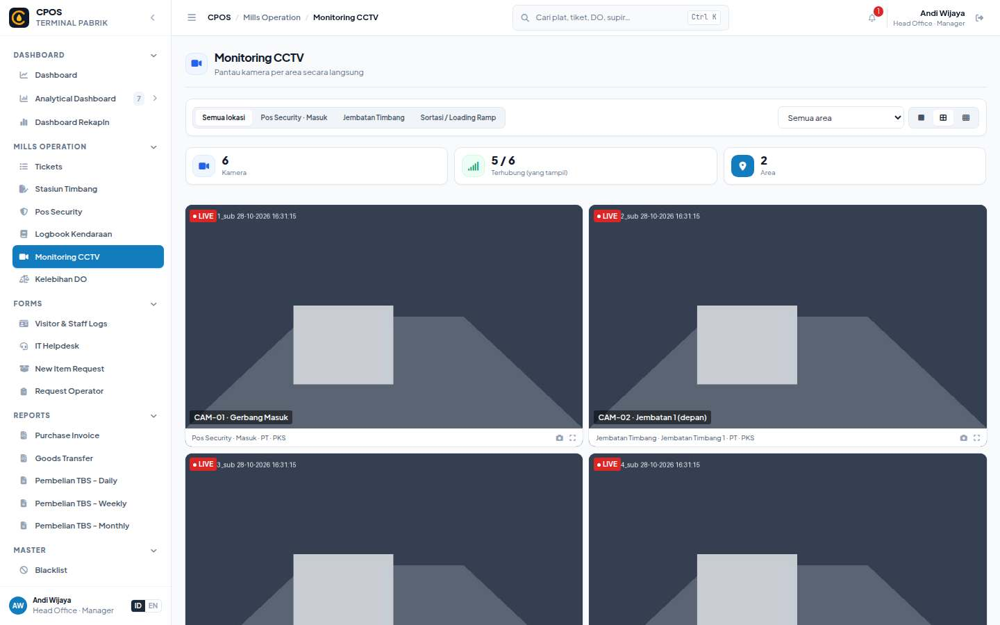

- Kamera yang tampil = kamera di area dalam **Cakupan data** Anda (Admin › Hak Akses › menu Monitoring CCTV).
- **Chip lokasi:** Pos Masuk / Pos Keluar / Jembatan / Sortasi / Umum (hanya lokasi yang punya kamera).
- **Area:** pilih area / cabang. **Grid:** 1, 2, atau 3 kolom.
- **Grid** memperbarui gambar tiap 2 detik; berhenti sendiri saat tab browser tidak dilihat.
- **Klik gambar** → layar penuh (video kualitas penuh). Siapa yang membuka tercatat di Log. Tutup dengan X / Esc.
- Kartu atas: jumlah kamera, kamera terhubung, area.
- Pemasangan: lihat `PANDUAN_CCTV.md`.

### D.6 Kelebihan DO

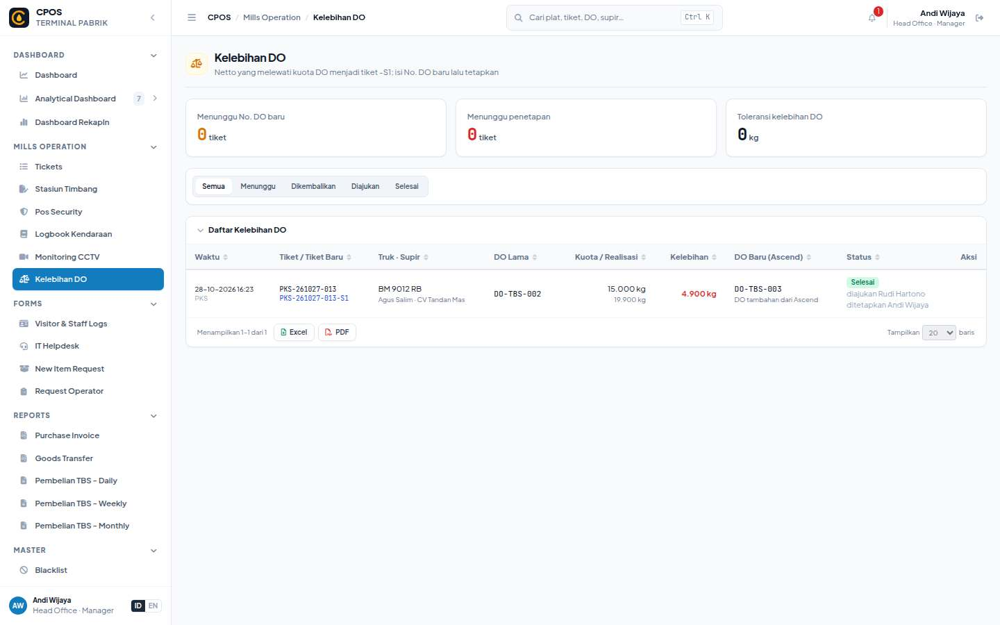

**Kapan muncul:** netto tiket melebihi sisa kuota DO (lebih dari toleransi di Pengaturan Site). Kelebihannya dijadikan tiket `-S1` yang perlu DO baru.

| Langkah | Siapa | Aksi |
|---|---|---|
| 1 | Operator timbang | **Isi DO Baru**: ajukan No. DO tambahan (dari Ascend) |
| 2 | HO | **Tetapkan** (DO baru dipakai) atau **Kembalikan** (minta operator memperbaiki) |
| 3 | – | Status **Selesai** |

- Chip filter: Semua / Menunggu / Dikembalikan / Diajukan / Selesai.
- Kartu atas: menunggu No. DO baru, menunggu penetapan, toleransi kelebihan.

---

## E. Forms

### E.1 Visitor & Staff Logs

Satu halaman untuk semua scan wajah: karyawan (absensi), supir, dan tamu. Tab: **Scan Wajah**, **Logs**, **Data Orang**.

#### E.1.1 Scan Wajah

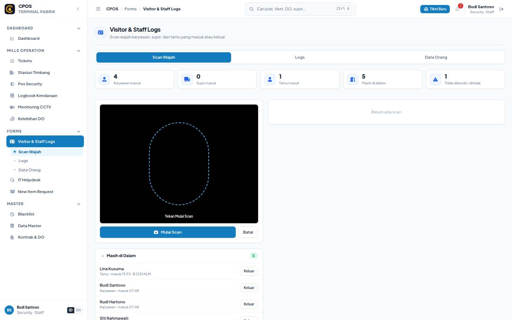

1. Tekan **Mulai Scan**; hadapkan wajah ke kamera (dalam garis oval).
2. Hasil:
   - **Karyawan** (termasuk security & BHL): absensi langsung tercatat MASUK / KELUAR, dengan status tepat waktu / terlambat dari Jadwal Kerja area.
   - **Supir / tamu:** muncul form kunjungan (keperluan, orang yang dituju, plat) → **Catat Masuk**. Bila masih di dalam, tombolnya **Catat Keluar**.
   - **Tidak dikenali:** dicatat sebagai bukti. Tombol **Daftarkan Orang** membuka form Tambah Orang dengan foto hasil scan.
   - **Diblacklist:** ditolak dan tercatat di Logs & Log Validasi Blacklist.
3. **Ringkasan hari ini:** karyawan, supir, tamu masuk; masih di dalam; tidak dikenali / ditolak.
4. **Masih di Dalam:** daftar orang di dalam area; tombol **Keluar** untuk mencatat keluar tanpa scan.

#### E.1.2 Logs

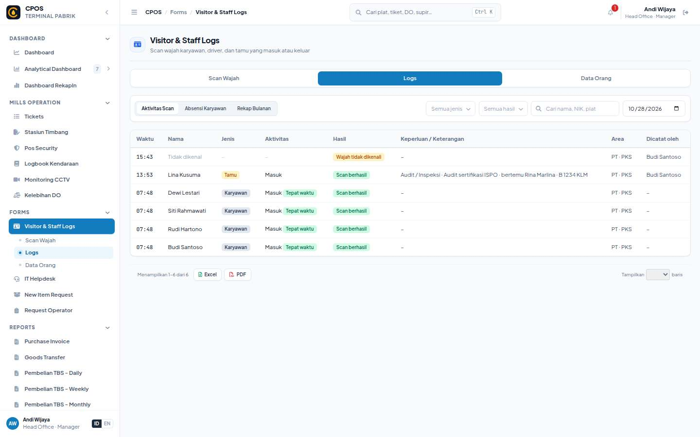

- Semua aktivitas scan (berhasil, tidak dikenali, ditolak) dengan foto bukti.
- Absensi karyawan harian dan rekap bulanan.
- Saring tanggal / jenis; ekspor di kaki tabel.

#### E.1.3 Data Orang (termasuk menambah supir)

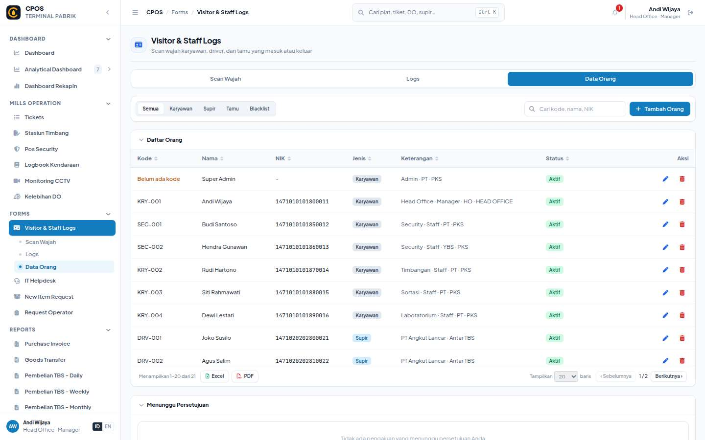

Daftar semua orang: karyawan, supir, tamu. Aksi: tambah / ubah / hapus (sesuai hak menu **Data Orang**).

**Menambah supir dari halaman ini** (tidak harus dari Data Master › Supir; datanya sama):

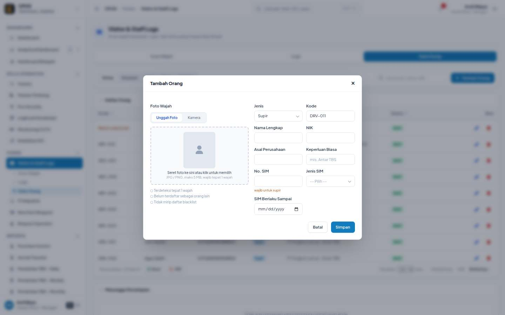

1. Buka tab **Data Orang** → **Tambah Orang**.
2. **Jenis** = **Supir**. Kode terisi otomatis (mis. `DRV-011`).
3. Isi Nama Lengkap, NIK (16 digit), Asal Perusahaan, Keperluan Biasa.
4. Isi **No. SIM, Jenis SIM, SIM Berlaku Sampai** (wajib untuk supir).
5. **Foto Wajah:** unggah foto atau ambil dari kamera. Syarat (dicek otomatis):
   - terdeteksi tepat 1 wajah;
   - belum terdaftar sebagai orang lain;
   - tidak mirip daftar blacklist.
6. **Simpan.**
   - Bila Alur Persetujuan **Data orang · Tambah** aktif untuk jenis Supir, orangnya baru aktif setelah disetujui (lihat bagian **Pengajuan** di bawah daftar).
   - Tanpa alur: langsung aktif.

Isian form menyesuaikan jenis: **Karyawan** → area, departemen, jabatan; **Tamu** → asal perusahaan, keperluan.

**Hapus:** ✏️ / 🗑 di baris. Hapus = dinonaktifkan; wajahnya tidak dikenali lagi, riwayat scan & tiket tetap ada. Orang yang diblacklist tidak bisa dihapus.

### E.2 IT Helpdesk

Menu disiapkan; isinya menyusul (halaman "Konten menyusul").

### E.3 New Item Request

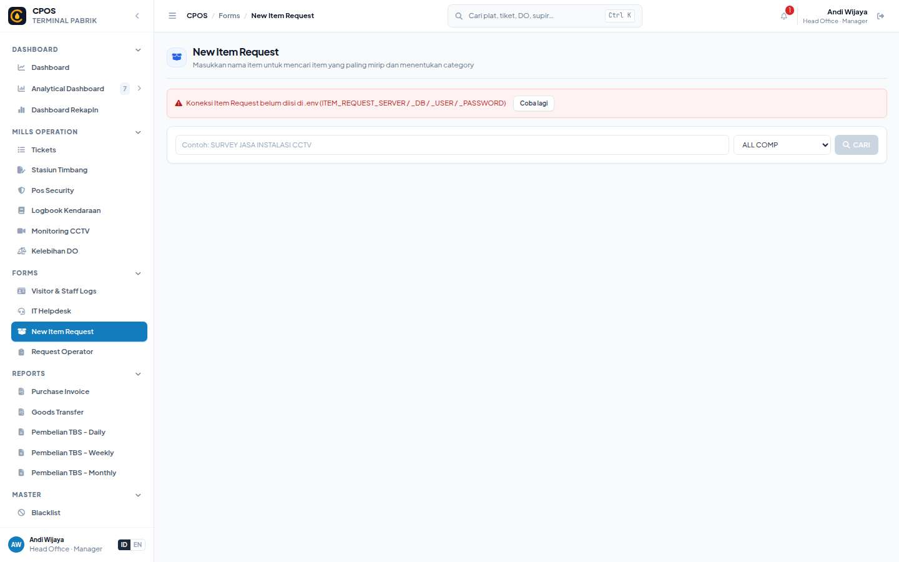

**Fungsi:** sebelum membuat item baru di Ascend, cek apakah item serupa sudah ada.

1. Pilih perusahaan (**COMP** / **ALL COMP**).
2. Ketik nama item, mis. "SURVEY JASA INSTALASI CCTV" → **CARI**.
3. Hasil:
   - **Predicted Category:** perkiraan kategori;
   - daftar item mirip: Item Code, Item Name, Category, Similarity, Last Purchase No, Price, Qty.
4. Bila sudah ada item yang sama, pakai item itu; bila tidak, ajukan item baru sesuai prosedur.

Butuh koneksi database Item Request di `.env` (`ITEM_REQUEST_SERVER / _DB / _USER / _PASSWORD`). Bila belum diisi, halaman menampilkan pesan itu.

### E.4 Request Operator

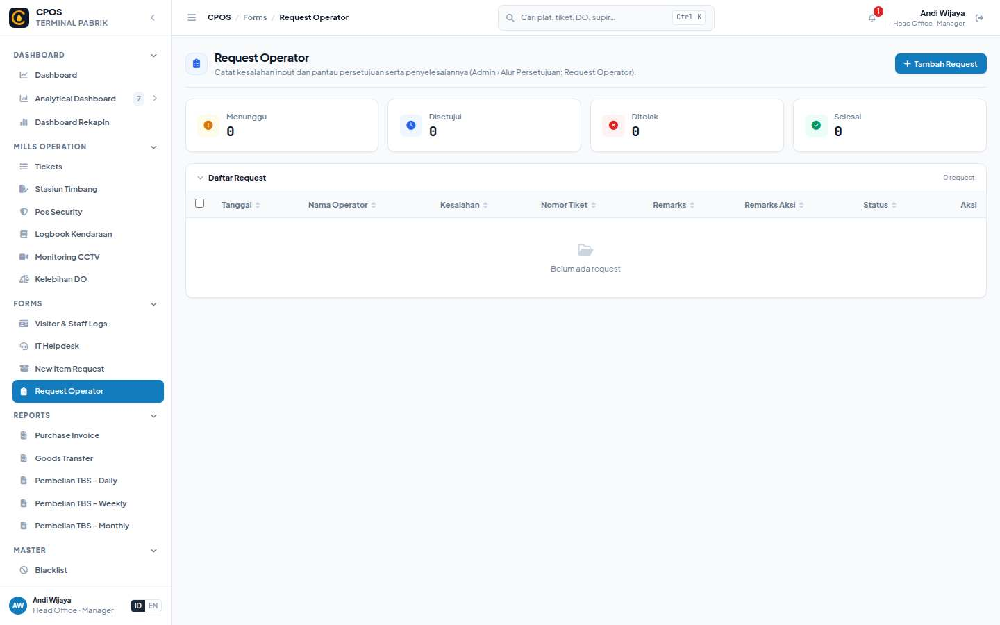

**Fungsi:** mencatat kesalahan input operator timbang (salah supplier, salah netto, dll.) dan memantau persetujuan serta penyelesaiannya di Ascend.

1. **Tambah Request:**
   - Nomor Tiket (ketik nomor tiket, plat, atau produk; diambil dari tiket 7 hari terakhir di Ascend);
   - Nama Operator, Kesalahan (dari Kategori Request), Remarks.
2. Persetujuan mengikuti **Admin › Alur Persetujuan › Request Operator**.
   - Penyetuju: **Setujui** / **Tolak** per baris, atau centang beberapa → **Setujui Terpilih**.
3. Setelah diperbaiki di sistem: **Tandai Selesai** + Remarks Aksi.

- Kartu atas: Menunggu, Disetujui, Ditolak, Selesai.

---

## F. Reports

| Menu | Isi |
|---|---|
| Purchase Invoice | Laporan Analytics: PI belum / sudah PVR |
| Goods Transfer | Laporan Analytics: transfer barang |
| Pembelian TBS – Daily / Weekly / Monthly | Laporan RekapIn dari ERP Ascend |
| Purchase Request, Purchase Orders, Item Transaction Reports | Menyusul (halaman "Konten menyusul") |

### F.1 Pembelian TBS (Daily / Weekly / Monthly)

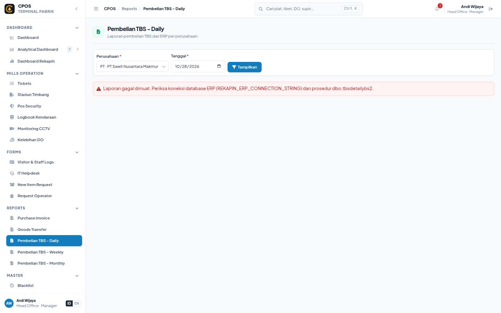

1. Pilih **perusahaan** dan **tanggal** (Daily) atau **Tanggal Awal – Tanggal Akhir** (Weekly / Monthly).
2. Tabel laporan: rincian pembelian per jenis harga, tonase, tonase CPO, attensi (naik / turun), baris ringkasan & TOTAL.
3. Ekspor Excel / PDF di judul setiap tabel.

Syarat:
- Kode perusahaan CPOS (Admin › Organisasi › Perusahaan) harus sama dengan `CompName` di Ascend (`Main.dbo.Company`), mis. YBS, SUN, SJN.
- Koneksi ERP diatur di `.env` (`REKAPIN_ERP_CONNECTION_STRING`). Bila gagal, halaman menampilkan pesan "Laporan gagal dimuat…".

---

## G. Master

### G.1 Blacklist

**Fungsi:** daftar orang (karyawan / supir / tamu), kendaraan, dan supplier yang dilarang masuk / bertransaksi. Sub-menu: Visitor & Staff Blacklist, Supplier Blacklist, Vehicle Blacklist.

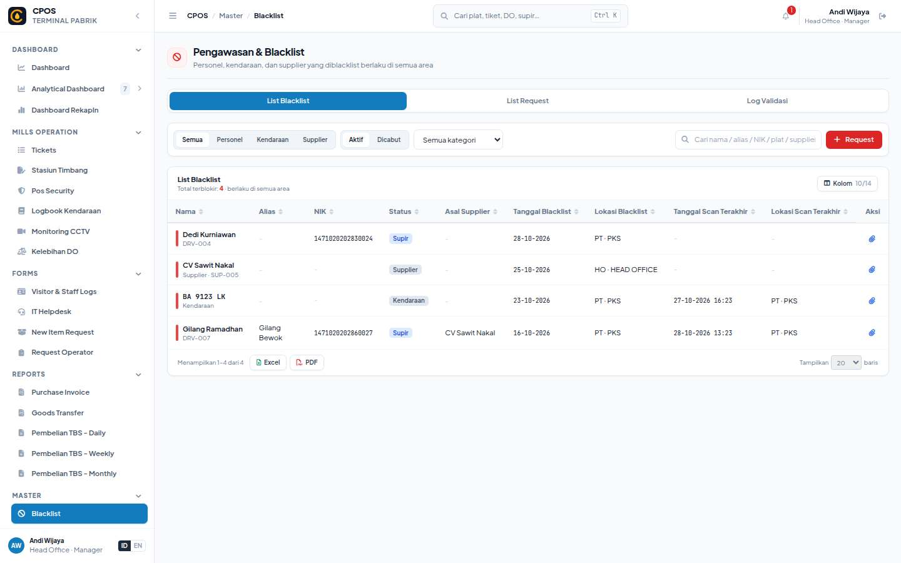

**Tab List Blacklist:**
- Daftar aktif dengan foto, alasan, sejak, dan surat.
- **Tambah Blacklist:**
  - pilih jenis target, orangnya / plat / supplier;
  - isi alasan dan info terkait (plat, asal supplier wajib untuk supir, pengangkutan);
  - lampirkan surat (bila diwajibkan).
- **Ajukan Hapus** untuk mencabut blacklist (dengan alasan).

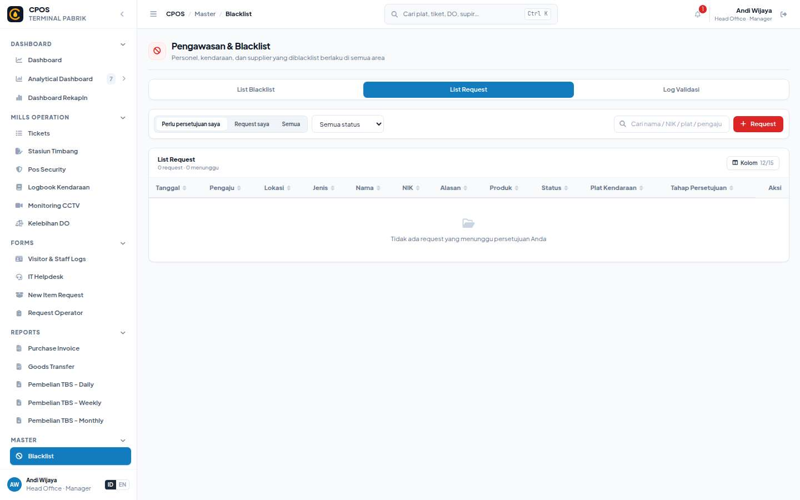

**Tab List Request:**
- Semua pengajuan tambah / hapus blacklist dan posisinya di alur.
- Penyetuju di tahap berjalan: **Setujui** / **Tolak** (dengan catatan).
- Pengaju bisa **Batalkan** pengajuannya selama belum diputuskan.
- Bertingkat sesuai **Admin › Alur Persetujuan**; tanpa alur = langsung berlaku.

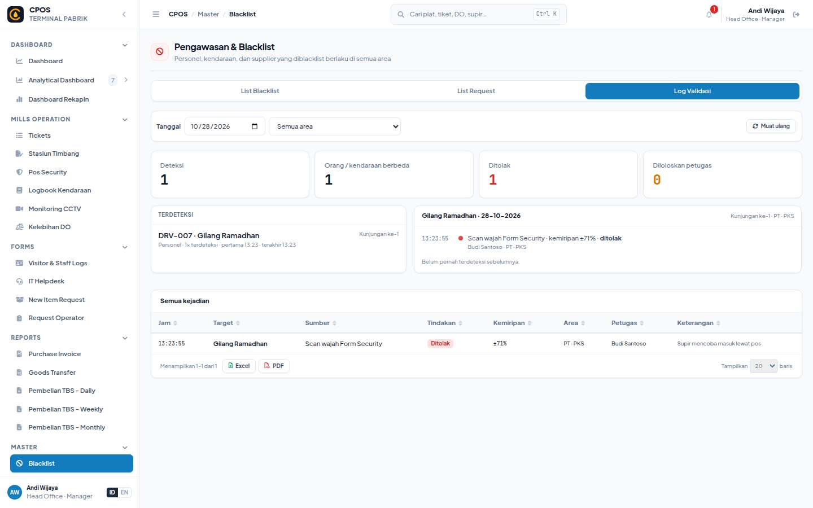

**Tab Log Validasi:** setiap kali blacklist terdeteksi (scan wajah, plat, supplier) di Pos Security / Stasiun Timbang / Visitor & Staff Logs.

### G.2 Data Master

Tab: **Supir, Kendaraan, Supplier, Produk, Mata Uang & Bank**.

**Supir**

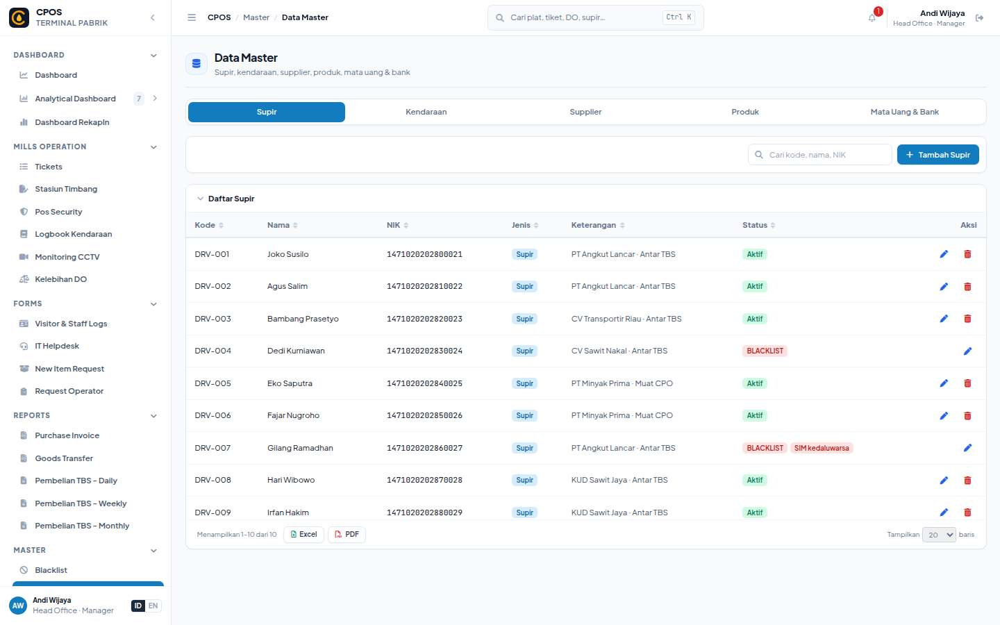

- Data supir, sama dengan Data Orang jenis Supir (E.1.3); boleh menambah dari sini atau dari Visitor & Staff Logs.
- Status: Aktif, BLACKLIST, SIM kedaluwarsa.

**Kendaraan**

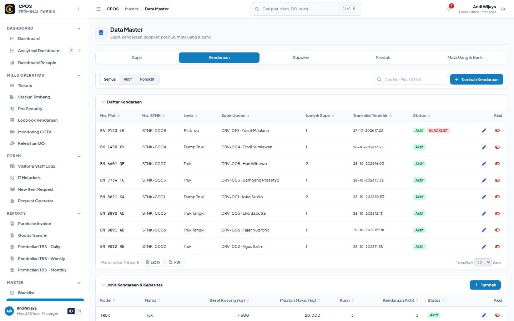

- **Daftar Kendaraan:**
  - No. Plat, No. STNK, Jenis, Supir Utama, jumlah supir, transaksi terakhir, status;
  - filter Semua / Aktif / Nonaktif;
  - **Tambah Kendaraan** (STNK wajib).
- **Jenis Kendaraan & Kapasitas:** berat kosong, muatan maksimal, kursi.
  - Dipakai untuk peringatan tara dan muatan.

**Supplier**

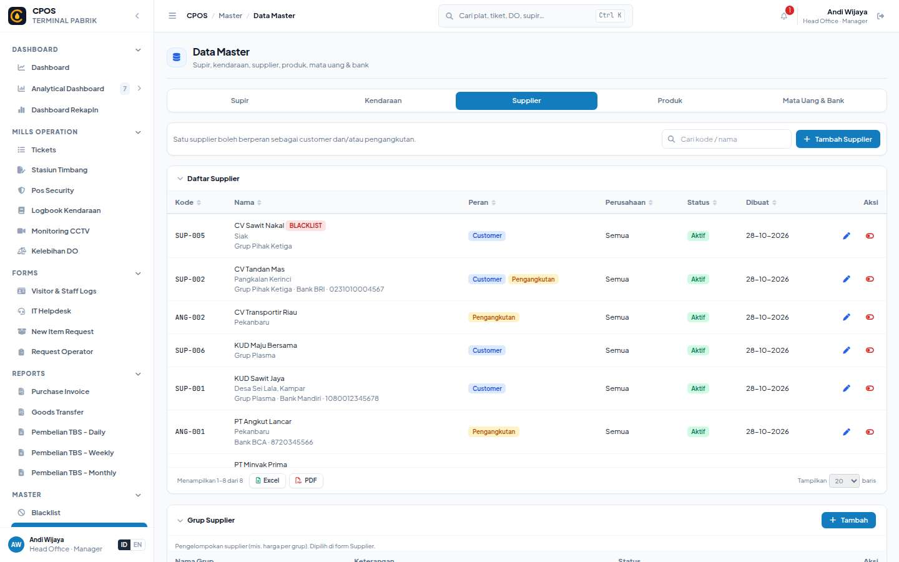

- Kode, nama, peran (customer / supplier / pengangkutan), perusahaan, status.

**Produk**

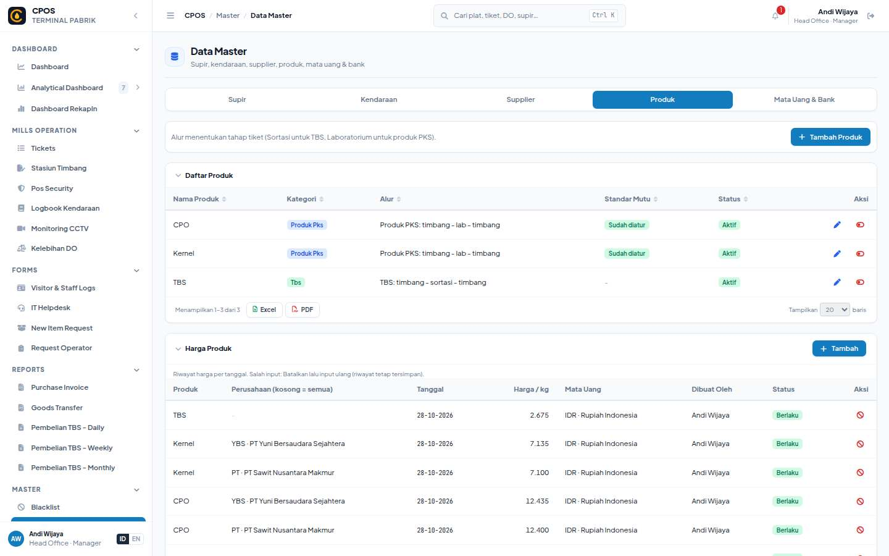

- Nama produk, kategori (TBS / produk PKS), **alur bawaan** (urutan tahap), standar mutu, status.

**Mata Uang & Bank**

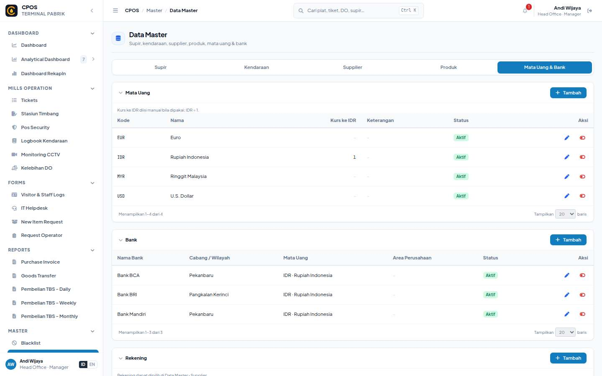

- Tabel referensi mata uang dan bank.

### G.3 Kontrak & DO

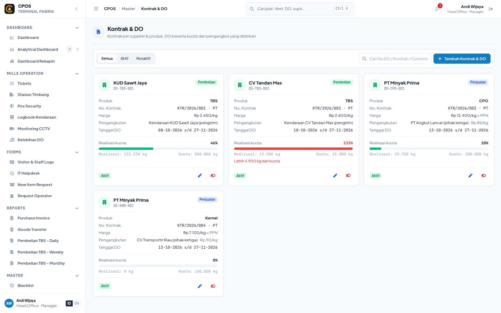

Setiap kartu = satu DO:
- supplier / customer, jenis (Pembelian / Penjualan), produk, No. Kontrak, harga, pengangkutan, tanggal DO;
- **Realisasi kuota:** bar hijau (aman) → merah bila melebihi kuota, dengan keterangan "Lebih x kg dari kuota".

Aksi:
- **Tambah Kontrak & DO:** isi kontrak (supplier, produk, harga), lalu DO (nomor, tanggal berlaku, kuota, pengangkut yang diizinkan);
- ✏️ ubah; tombol nonaktifkan;
- cari No DO / Kontrak / Customer; filter Semua / Aktif / Nonaktif.

### G.4 Harga CPO & Kernel

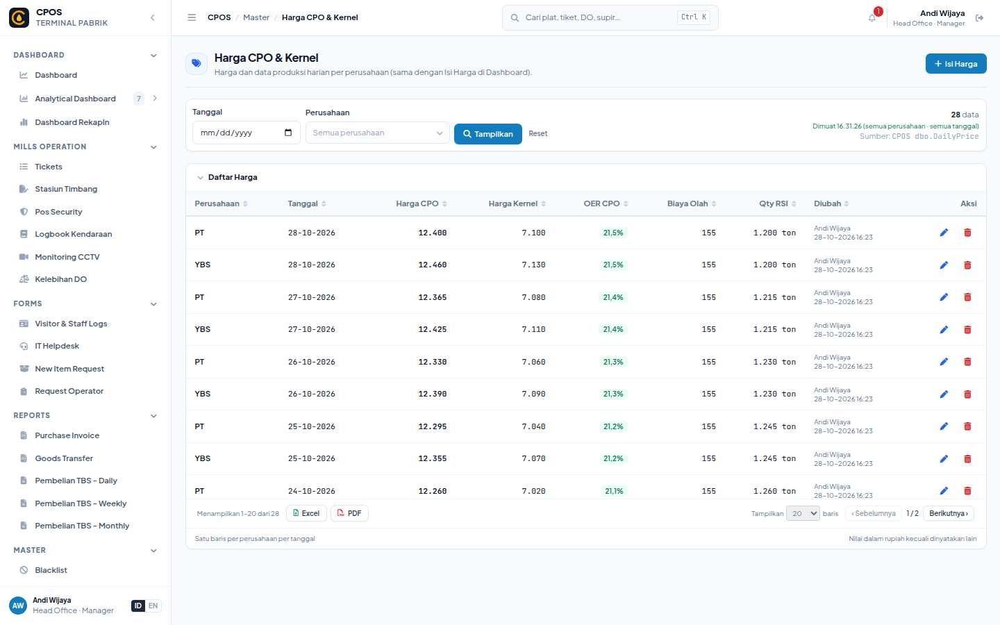

- Harga dan data produksi harian per perusahaan (sama dengan **Isi Harga** di Dashboard): Harga CPO, Kernel, OER CPO, Biaya Olah, Harga TBS, Qty RSI.
- Satu baris per perusahaan per tanggal. Tanggal yang sudah ada harganya akan diperbarui.
- Nilai dalam rupiah kecuali dinyatakan lain.

### G.5 Kategori Request

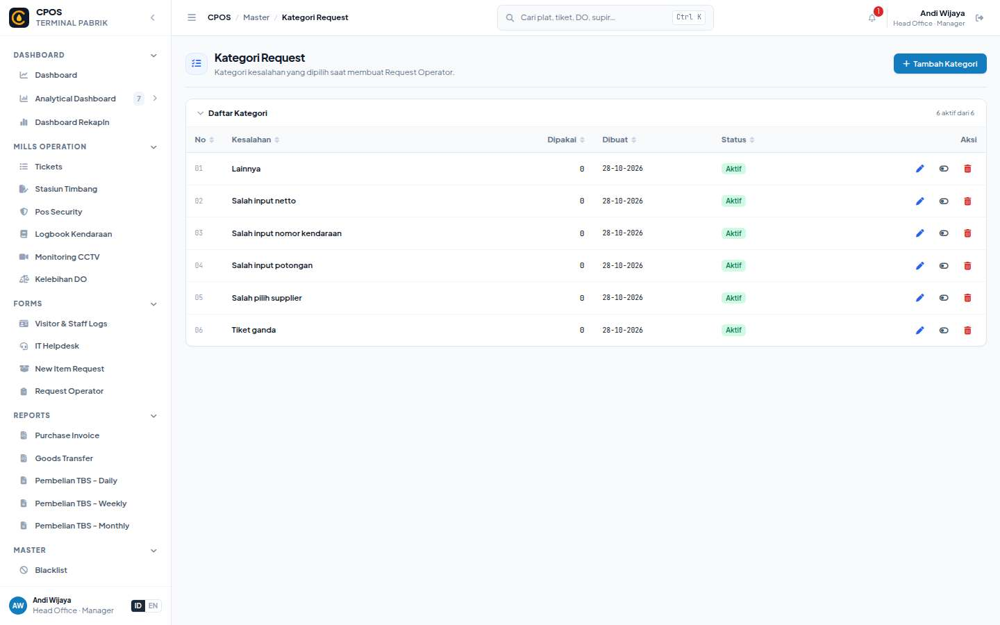

- Kategori kesalahan yang dipilih saat membuat Request Operator (mis. "Salah pilih supplier").
- **Tambah Kategori**, ubah, hapus.
- Kategori yang sudah dipakai request hanya bisa dinonaktifkan (tidak dihapus).

---

## H. Konsol Admin

Login dengan akun admin menampilkan **Konsol Admin** (menu khusus admin).

### H.1 Kelola Pengguna

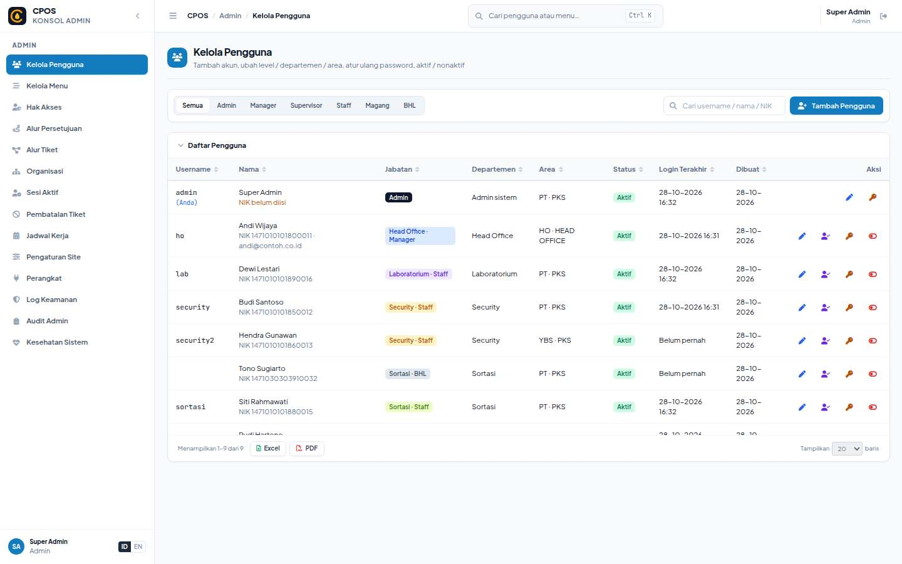

- **Daftar akun:** username, nama, jabatan, area, status, login terakhir.
- **Tambah Pengguna:**

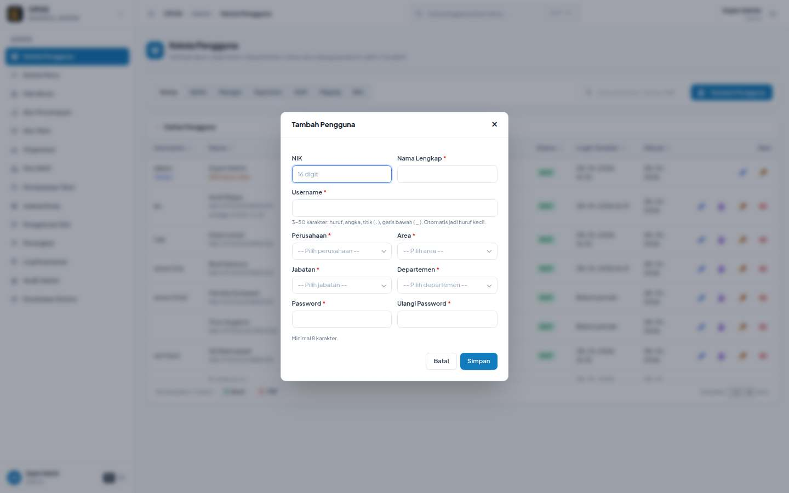

1. **NIK:** bila NIK sudah terdaftar di Data Orang, nama terisi sendiri dan akun dihubungkan ke orang itu.
2. Nama Lengkap.
3. **Username:** 3–50 karakter (huruf, angka, titik, garis bawah); otomatis huruf kecil; tidak boleh tanda hubung.
4. Perusahaan, Area, Jabatan, Departemen.
5. Password + Ulangi Password (minimal 8 karakter). Pengguna wajib mengganti password saat login pertama.

Aksi per baris:
- ✏️ ubah;
- 🔑 atur ulang password;
- nonaktifkan / aktifkan.

### H.2 Kelola Menu

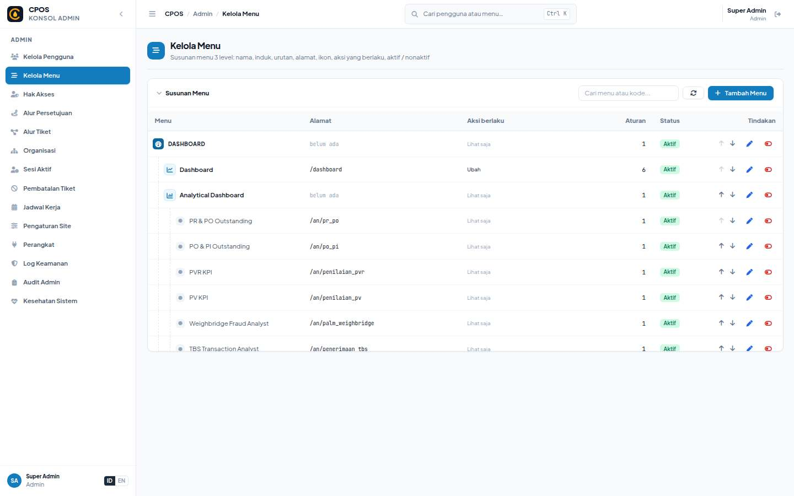

- **Pohon menu 3 tingkat:** Grup (Lv1) → Halaman (Lv2) → Bagian / tab (Lv3).
- Tambah / ubah menu: kode, nama, ikon (Font Awesome, mis. `fa-video`), alamat (URL), urutan, aktif.
- Menu tanpa alamat tampil redup / "Konten menyusul".

### H.3 Hak Akses

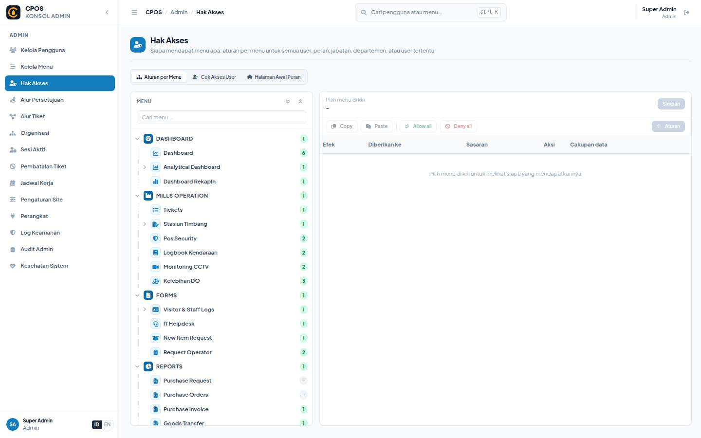

Tiga tab: **Aturan per Menu**, **Cek Akses User**, **Halaman Awal Peran**.

**Aturan per Menu:**
1. Pilih menu di kiri (angka hijau = jumlah aturan).
2. **+ Aturan**, lalu isi:
   - **Efek:** Izinkan / Tolak;
   - **Diberikan ke:** semua user, peran, jabatan, departemen, atau user tertentu;
   - **Sasaran** (bila ada);
   - **Aksi:** Lihat, Tambah, Ubah, Hapus, Setujui, … (hanya aksi yang ada di menu itu);
   - **Cakupan data:** Area sendiri / PT sendiri / Semua PT / PT tertentu;
   - **Isi Dashboard** (khusus menu Dashboard).
3. **Copy / Paste** aturan antar-menu; **Allow all / Deny all** per baris.
4. **Simpan** (muncul tanda "Belum disimpan" bila ada perubahan).

Aturan **Tolak** mengalahkan **Izinkan**. Cakupan data dari beberapa aturan digabung.

**Cek Akses User:** pilih pengguna → daftar menu, haknya, dan aturan asalnya.

**Halaman Awal Peran:** halaman yang pertama dibuka setelah login per peran.

### H.4 Alur Persetujuan

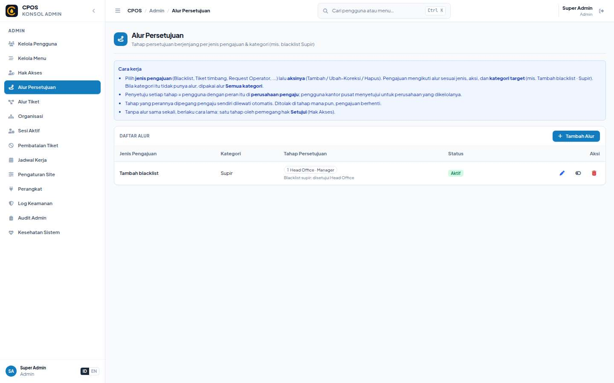

- **Persetujuan bertingkat** per jenis pengajuan (Blacklist, Tiket timbang / koreksi, Data orang, Request Operator, …), aksi (Tambah / Ubah-Koreksi / Hapus), dan kategori target (mis. Tambah blacklist · Supir).
- **Setiap tahap:** siapa penyetujunya (peran / jabatan / user) dan jumlah persetujuan yang dibutuhkan.
- **Semua kategori** = cadangan bila kategori itu tidak punya alur sendiri.
- **Tanpa alur:** pengajuan memakai cara lama (satu tahap, hak Setujui).

### H.5 Alur Tiket

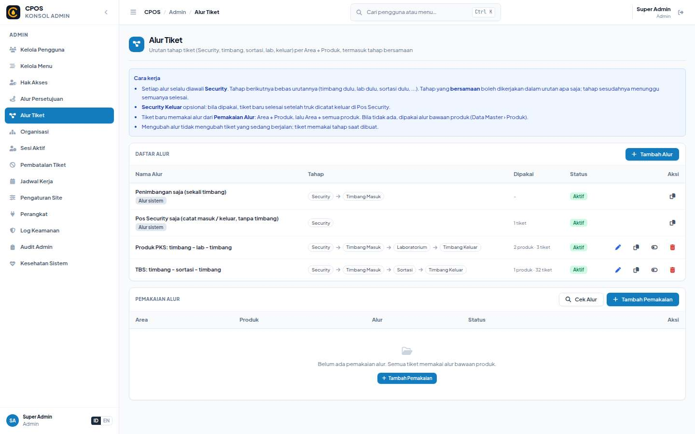

- **Daftar Alur:** urutan tahap tiket (Security → Timbang Masuk → Sortasi / Laboratorium → Timbang Keluar → Security Keluar opsional).
  - Tahap **bersamaan** boleh dikerjakan dalam urutan apa saja.
  - Alur sistem tidak bisa dihapus; bisa disalin.
- **Pemakaian Alur:** alur untuk Area + Produk tertentu. Tanpa pemakaian, dipakai alur bawaan produk (Data Master › Produk).
- **Cek Alur:** melihat alur mana yang dipakai untuk kombinasi area + produk.
- Mengubah alur tidak mengubah tiket yang sedang berjalan.

### H.6 Organisasi

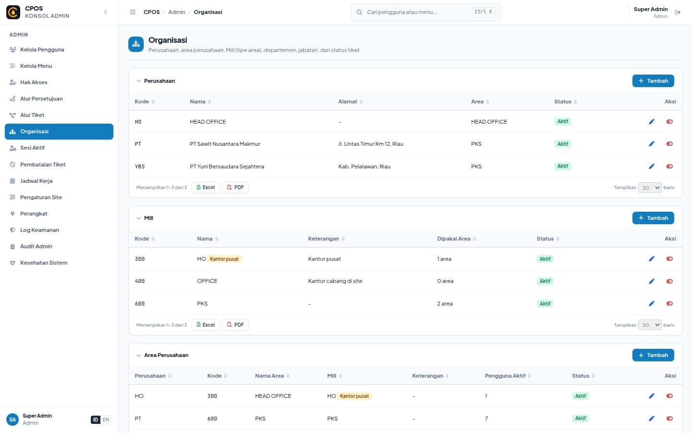

Tabel: **Perusahaan, Lokasi (Mill), Area, Departemen, Jabatan, Status Tiket**.

| Tabel | Isi |
|---|---|
| Perusahaan | Kode PT, mis. YBS, SUN, SJN, ORI, HO; harus sama dengan kode di Ascend |
| Lokasi (Mill) | Jenis lokasi, mis. PKS, OFFICE, HEAD OFFICE |
| Area | Lokasi nyata milik perusahaan, mis. YBS · PKS. Area menentukan nomor tiket, cakupan data, kamera, jembatan timbang |
| Departemen | Bagian kerja (Security, Timbangan, Sortasi, Lab, HO, …) |
| Jabatan | Departemen + level, mis. Security · Staff, Sortasi · BHL |
| Status Tiket | Nama & warna status tiket yang tampil di layar |

### H.7 Sesi Aktif

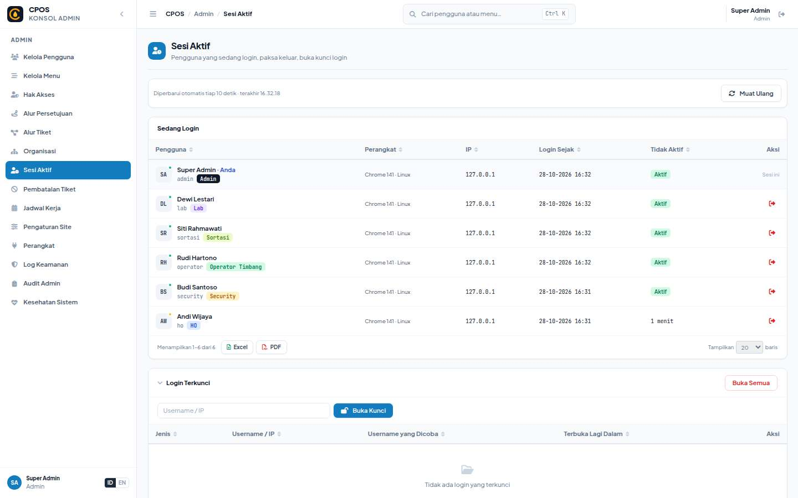

- **Pengguna yang sedang login:** perangkat, IP, sejak kapan, lama tidak aktif.
- **Akhiri Sesi** untuk memaksa keluar pengguna lain. Sesi sendiri bertanda "Sesi ini"; pakai tombol keluar di kanan atas.
- **Login terkunci** (salah password berulang): **Buka Kunci** per username / IP.

### H.8 Pembatalan Tiket (Void)

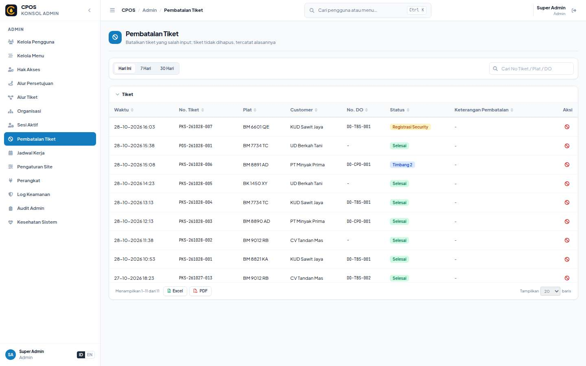

- Daftar tiket yang bisa dibatalkan.
- **Batalkan:** isi alasan (minimal 5 karakter). Tiket berstatus Dibatalkan.
- **Lampirkan BA:** unggah Berita Acara pembatalan.

### H.9 Jadwal Kerja

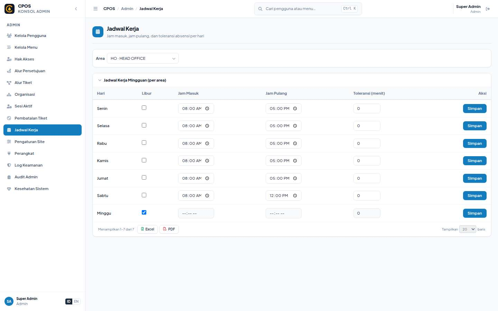

- Per area dan per hari: libur, jam masuk, jam pulang, toleransi terlambat (menit).
- Dipakai absensi karyawan di Visitor & Staff Logs.

### H.10 Pengaturan Site

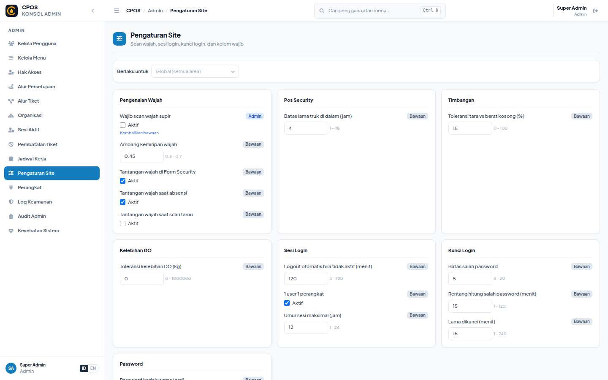

- **Berlaku untuk:** Global (semua area) atau area tertentu (menimpa nilai global).
- **Kelompok pengaturan:**
  - Pengenalan Wajah: wajib scan wajah supir, ambang kemiripan, tantangan wajah;
  - Pos Security: batas lama truk di dalam;
  - Timbangan: toleransi tara vs berat kosong;
  - Kelebihan DO: toleransi kg;
  - Sesi Login: logout otomatis, 1 user 1 perangkat, umur sesi;
  - Kunci Login: batas salah password, lama dikunci;
  - Password: kedaluwarsa (hari).
- **Label:** "Bawaan" = memakai nilai bawaan; **Kembalikan bawaan** menghapus nilai khusus.
- **Terapkan ke semua area company ini:** menyalin nilai area ke area lain di PT yang sama.
- **Kolom Wajib:** pilih isian form yang wajib diisi (mis. No. STNK di form Security). Tanda `*` muncul otomatis di form.

### H.11 Perangkat

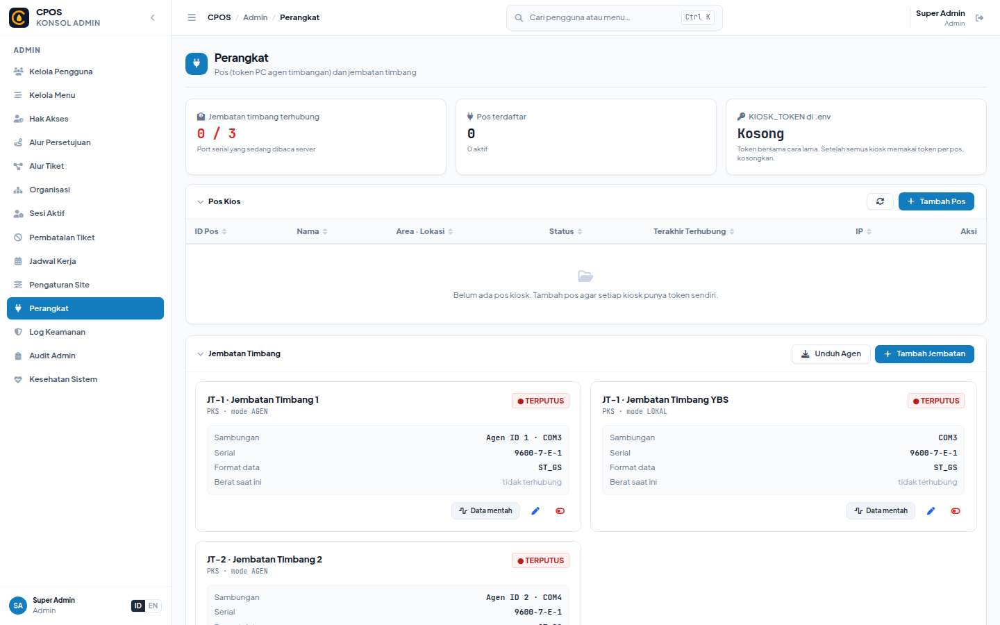

| Bagian | Isi |
|---|---|
| Jembatan Timbang | Kode, nama, area, profil merk indikator, port serial / LAN, status; **Data mentah** untuk melihat data yang masuk dari indikator |
| Kios / Pos | Perangkat kiosk (mis. tablet scan wajah) dengan token; **Ganti Token** bila bocor |
| Gateway Video (CCTV) | Alamat go2rtc per area + **Tes Koneksi** |
| Kamera CCTV | Kode, nama, area, gateway, titik, jembatan, peran, merk, nama stream utama / sub; **Tes Koneksi** menampilkan gambar |

Detail CCTV: `PANDUAN_CCTV.md`.

### H.12 Log Keamanan

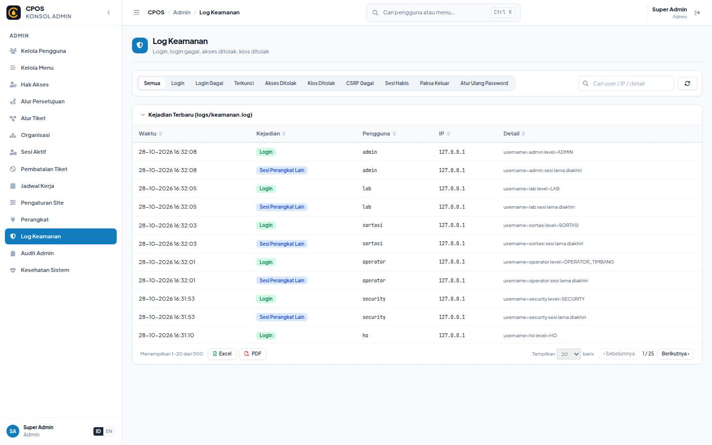

- Login berhasil / gagal, akun terkunci, reset password, CSRF gagal, dll.
- Kolom: waktu, user, IP, kejadian, detail. Cari & ekspor.

### H.13 Audit Admin

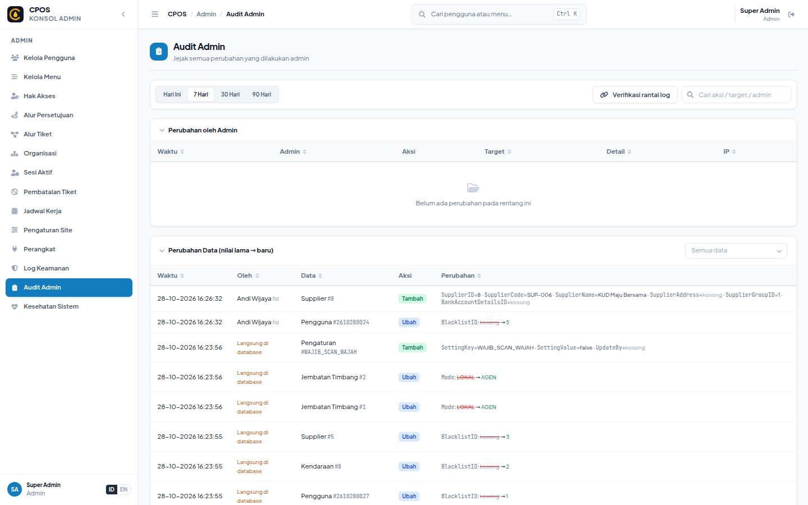

- **Audit Admin:** perubahan yang dilakukan admin (tambah user, ubah hak, dll.).
- **Log Perubahan Data:** perubahan data penting (sebelum → sesudah) dengan rantai hash. Tombol cek keutuhan memastikan log tidak diubah.

### H.14 Kesehatan Sistem

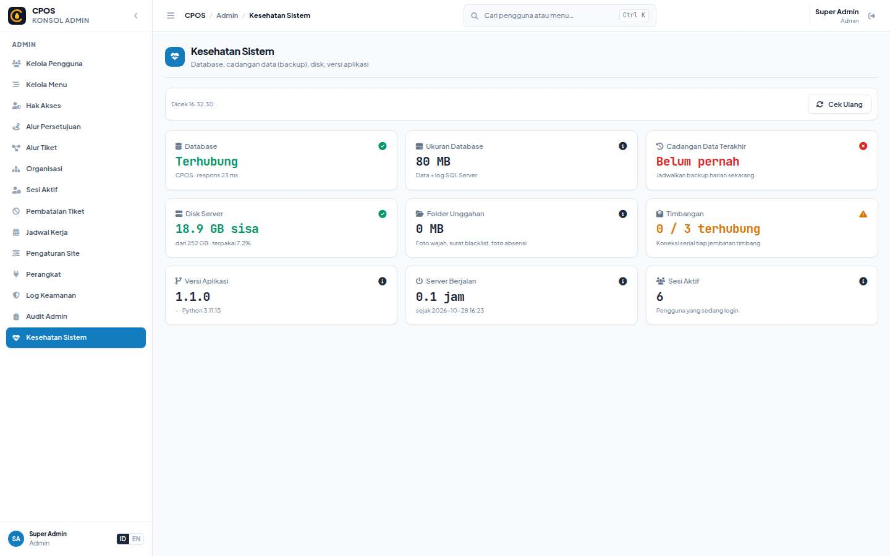

| Kartu | Arti |
|---|---|
| Database / Ukuran Database | Koneksi & ukuran database |
| Cadangan Data Terakhir | Backup terakhir. Merah "Belum pernah" → jadwalkan backup harian |
| Disk Server | Sisa ruang disk |
| Folder Unggahan | Ukuran foto wajah, surat, foto absensi |
| Timbangan | Jembatan timbang terhubung |
| Versi Aplikasi / Server Berjalan / Sesi Aktif | Informasi server |

Tekan **Cek Ulang** untuk memperbarui.

---

## I. Pertanyaan umum & masalah

| Pertanyaan / masalah | Jawaban |
|---|---|
| Menu tidak muncul | Belum diberi hak Lihat. Minta admin memeriksa **Hak Akses › Cek Akses User** |
| Data PT / area lain tidak terlihat | Cakupan data aturan Anda hanya area / PT sendiri. Minta admin mengubah **Cakupan data** di Hak Akses |
| Tambah supir harus dari Data Master? | Tidak. Bisa dari **Visitor & Staff Logs › Data Orang › Tambah Orang** (jenis Supir), atau dari scan wajah tidak dikenali → **Daftarkan Orang** |
| Username ditolak | Username hanya huruf, angka, titik, garis bawah (3–50). Huruf besar otomatis jadi kecil. Tidak boleh spasi / tanda hubung |
| Lupa password | Minta admin **Atur Ulang Password** (Kelola Pengguna); ganti password saat login berikutnya |
| Akun terkunci | Tunggu lama kunci habis, atau admin **Buka Kunci** di Sesi Aktif |
| Timbangan "TERPUTUS" | Cek kabel indikator / agen PC jembatan; status di Admin › Perangkat & Kesehatan Sistem |
| "Timbangan belum kembali ke 0" | Pastikan truk sebelumnya sudah turun; tekan ZERO di indikator bila angka tersisa |
| Kamera tidak tampil | Lihat `PANDUAN_CCTV.md` bagian D |
| Halaman "Akses Ditolak" (403) | Anda tidak punya hak untuk halaman itu; tekan **Kembali** |
| Halaman "Terjadi Kesalahan" (500) | Catat **Kode error** (mis. `ERR-1028-1415-A7F3`) dan No. Tiket, lalu hubungi IT |
| Bahasa Inggris | Tombol **EN** di kiri bawah / halaman login. Isi data (nama, plat) dan laporan Analytics tetap seperti aslinya |

---

## J. Istilah

| Istilah | Arti |
|---|---|
| TBS | Tandan Buah Segar (bahan baku sawit) |
| CPO / Kernel | Crude Palm Oil / inti sawit (produk PKS) |
| PKS | Pabrik Kelapa Sawit |
| OER | Oil Extraction Rate (rendemen minyak) |
| DO | Delivery Order: izin pengiriman dengan kuota berat |
| Bruto / Tara / Netto | Berat truk + muatan / berat truk kosong / berat muatan (bruto − tara) |
| Potongan sortasi | Pengurangan berat karena mutu buah (buah mentah, busuk, sampah, dll.) |
| FFA | Free Fatty Acid: kadar asam lemak bebas (mutu CPO) |
| COA | Certificate of Analysis: sertifikat hasil uji lab |
| Void / BA | Pembatalan tiket / Berita Acara |
| Cakupan data | Batas area / PT yang datanya boleh dilihat suatu aturan hak akses |
| Alur Persetujuan | Tahapan siapa saja yang harus menyetujui suatu pengajuan |
| Alur Tiket | Urutan tahap yang dilalui tiket (security, timbang, sortasi / lab, timbang, keluar) |
| Ascend | Sistem ERP perusahaan (sumber PR, PO, PI, DO, item) |
| BHL | Buruh Harian Lepas |
